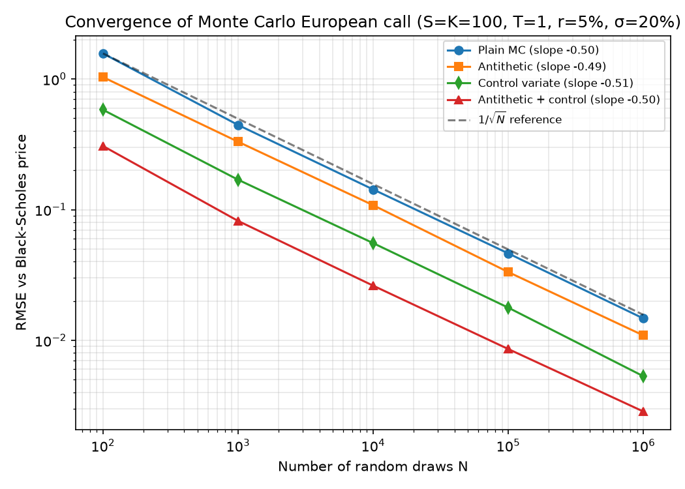
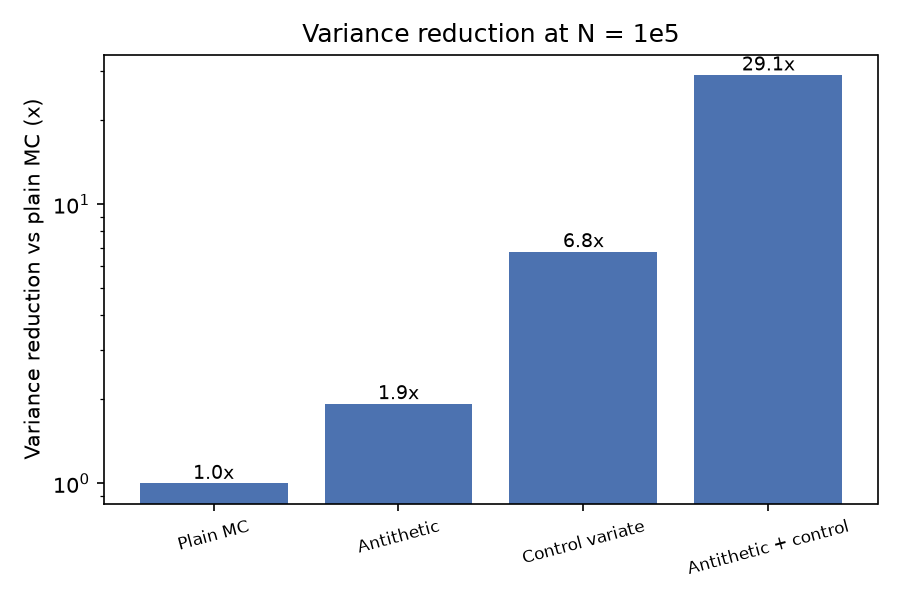

# Monte Carlo Option Pricer, validated against Black-Scholes

Prices European options by Monte Carlo (MC) simulation, checks the result against the Black-Scholes closed form, measures how the error shrinks with the number of paths, and adds two variance reduction techniques (antithetic variates, control variates).

## Problem
MC estimates are noisy. How fast does the error shrink, and how much accuracy can we buy for free (same number of random draws) with variance reduction?

## Method
- **Model:** risk-neutral GBM, `S_T = S0 · exp((r − σ²/2)T + σ√T·Z)`, `Z ~ N(0,1)`.
- **Benchmark:** Black-Scholes closed form (`bs_price`).
- **Plain MC:** average of discounted payoffs; standard error = sample std / √N.
- **Antithetic variates:** simulate pairs `(Z, −Z)` and average each pair; the negatively correlated payoffs cancel noise.
- **Control variate:** use `Y = e^{−rT} S_T`, whose expectation is known exactly (`S0`). Estimate `β = Cov(X,Y)/Var(Y)` from the sample and price with `X − β(Y − E[Y])`.
- **Fair comparison:** every method uses the same total number of normal draws N.
- **Setup:** European call, S = K = 100, T = 1, r = 5%, σ = 20%. Black-Scholes price = **10.4506**.

## Results (reproduce with `python run_experiments.py`)

**1. Error shrinks as 1/√N.** Log-log slope of RMSE vs N is about −0.5 for every method (fitted: −0.504 plain, −0.495 antithetic, −0.506 control, −0.504 combined). Variance reduction shifts the line down; it does not change the rate.



**2. Variance reduction (N = 100,000 draws, repeated runs):**

| Method | Variance reduction vs plain | RMSE at N=1e5 |
|---|---|---|
| Plain MC | 1.0x | 0.0463 |
| Antithetic | 1.9x | 0.0333 |
| Control variate | 6.8x | 0.0178 |
| Antithetic + control | **29.1x** | **0.0086** |

The combined estimator has about 5.4x lower RMSE than plain MC for the same number of draws. Plain MC would need roughly 29x more paths to match it.



**3. Sanity checks.**
- Empirical coverage of the 95% confidence interval is 0.945–0.963 across methods, so the reported standard errors are well calibrated.
- Single run, N = 1e6: plain MC 10.4288 ± 0.0288 vs combined 10.4542 ± 0.0054 (95% CI), against the true 10.4506.
- Put-call parity and MC-vs-BS tests in `tests/` (`pytest`).

## Limitations
- Only European payoffs under constant-volatility GBM, where a closed form exists. MC's real value is on path-dependent products (Asian, barrier) and richer models (stochastic vol); extending to those is the natural next step.
- The control variate coefficient β is estimated from the same sample, which introduces a tiny bias (negligible at these N). Coverage results above suggest it does not matter in practice.
- Variance reduction gains depend on the option: the stock-price control works best when the payoff is highly correlated with S_T (e.g. deep ITM calls) and less well for far-OTM options.
- No dividends in the experiments (supported in code via `q`).

## Run it
```bash
pip install -r requirements.txt
python run_experiments.py   # prints tables, saves figures/
pytest                      # tests
```
Files: `mc_pricer.py` (pricer), `run_experiments.py` (experiments and plots), `results.txt` (raw output).
